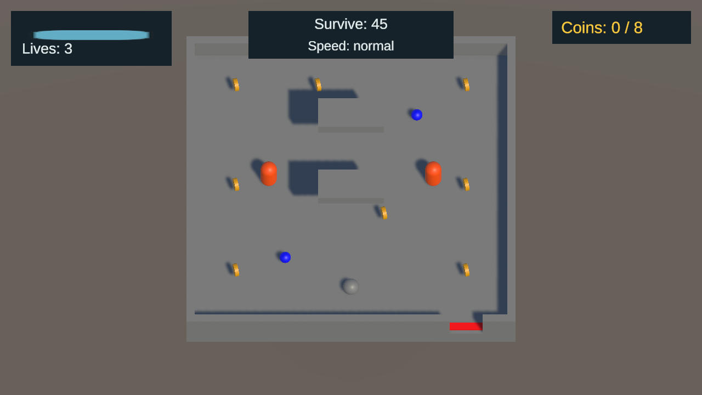
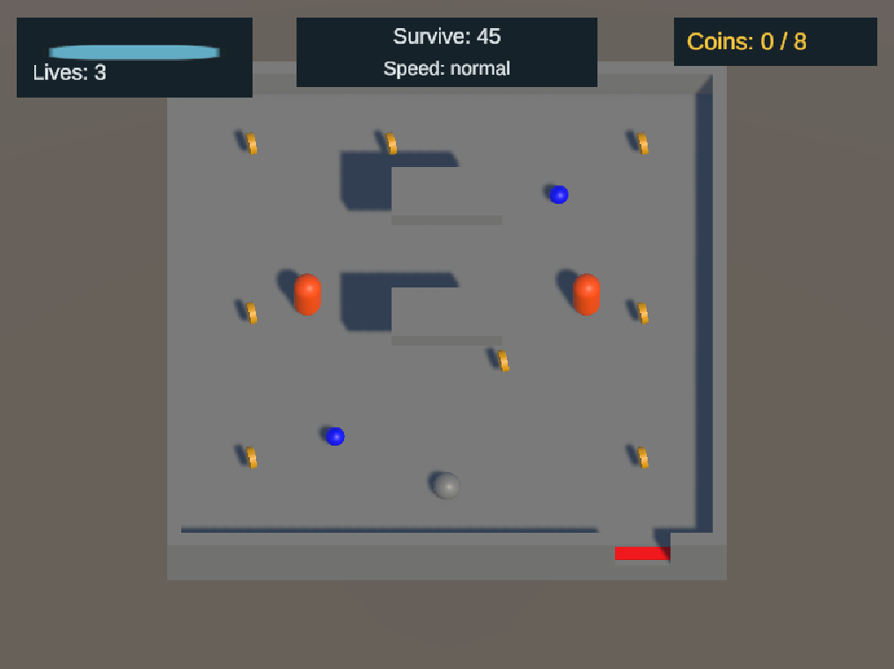
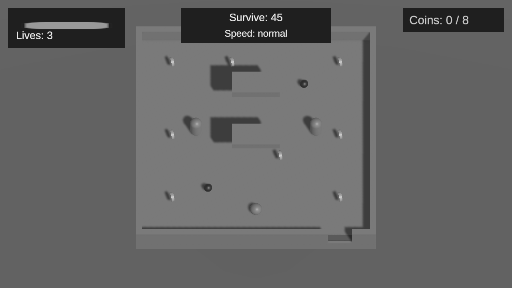

# CS464 Assignment 04 . Muhammad Abdullah Usman . BSCS25061
**Video (90-180 s):** https://drive.google.com/file/d/1K-H4-HSiCLK6vSW-xnx8VV8TEfSWETWf/view?usp=sharing

## Settings
| Part | Setting | Value | Why |
|---|---|---|---|
| A | Harmony . base hue | split-complementary . 195 | A calm teal base; the two warm accents opposite it pull the eye to score and danger |
| A | Dark . mid . light | #122329 . #66B3CC . #E9F4F7 | Panels, buttons and text sit at three different values, so they still separate in grayscale |
| A | Accents | #FFCF40 . #F24973 | Gold for coins and score, red for damage and an empty health bar |
| A | HUD text (#E9F4F7) on its panel (#122329) | 14.44 : 1 | Text sits on a solid panel, well above 4.5 : 1 |
| A | Button label (#122329) on the button (#66B3CC) | 6.84 : 1 | A dark label, because white on this teal is only 2.11 : 1 |
| B | Music . SFX groups, as mixed | 0 dB . 0 dB | Both groups at unity; the music source sits at 0.5 volume so effects stay on top |
| B | Slider at 1 . 0.5 . 0.0001 | 0 dB . -6 dB . -80 dB | Log10(v) x 20, so the slider's bottom is silence |
| C | Guard hum, in Level 3 | Logarithmic . Min 1 m . Max 12 m | Min is the guard's size; a natural fade you can hear coming from half the arena away |
| C | Crusher thud, in Level 4 | Linear . Min 2 m . Max 10 m | Min covers the crusher; linear goes silent at 10 m, so only nearby crushers are heard |
| C | AudioListener | on the player | The camera is a fixed top-down view several metres away, so ListenerOnPlayer follows the ball's position |
| D | unlocked | int . default 1 | Level 1 is always open on a fresh install |
| D | best1 - best5 | float . HasKey first | No key means no time yet, so no fake 0.0 s best |
| D | MusicVolume | float . default 1 | Full volume on first run, and never Log10(0) |

## Answers
1. **What `Time.timeScale = 0` stops in my game, and what it doesn't:** It stops physics and FixedUpdate, so the ball, guards and crushers freeze, plus anything using Time.deltaTime: the coin spin, LevelTimer and the respawn WaitForSeconds. It does not stop Update, input, the EventSystem or audio. So PlayerController returns early while PauseMenu.IsPaused, Esc is still read in PauseMenu.Update, menus work from the keyboard, the health bar's lag runs on unscaled time, and I pause sound with AudioListener.pause.
2. **What survives a LoadScene in my game, and how:** Music and SfxPlayer survive through DontDestroyOnLoad, and each checks for an existing instance in Awake, so only one of each is ever kept. PlayerPrefs keys (unlocked, best1 to best5, MusicVolume) survive because they are on disk. Statics survive too: PauseMenu.IsPaused, Time.timeScale and AudioListener.pause, which is why Restart and Quit call Resume() first and LevelLoader.Load sets the time scale back to 1. Everything else is rebuilt.
3. **Why every PlayerPrefs read in my game has a default:** On a fresh install no key exists yet. GetInt("unlocked", 1) returns 1, so Level 1 is open instead of every level being locked. GetFloat("MusicVolume", 1f) gives full volume instead of 0, which would make Log10 return minus infinity. Best times check HasKey first, so the level select shows "Level 2" rather than a fake 0.0 s record. Every key is spelled once, inside SaveData.
4. **An exception a forgotten unsubscribe would throw, and why mine can't:** If a listener did += on a static event and never -=, it would stay subscribed after a restart destroyed it, and the next hit would call into a destroyed component and throw a MissingReferenceException. In my game HealthBarListener, HurtSound and HitSparks all subscribe to Health.Damaged in OnEnable and unsubscribe in OnDisable. OnDisable runs when the scene unloads, so nothing destroyed is ever left subscribed.

## Credits
- "Bossa Nova" (8bit Bossa.mp3) . Joth . https://opengameart.org/content/bossa-nova . CC0
- Sound effects (coin, hit, click, win, lose, guard hum, crusher thud) . Kenney . https://kenney.nl/assets . CC0